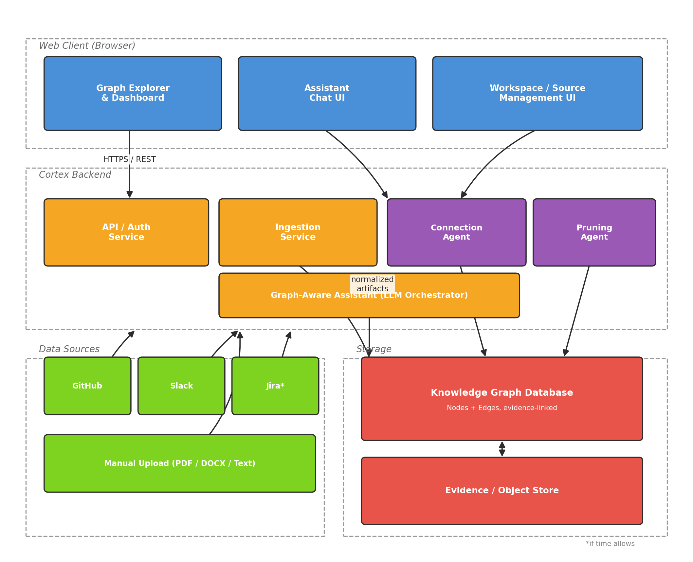
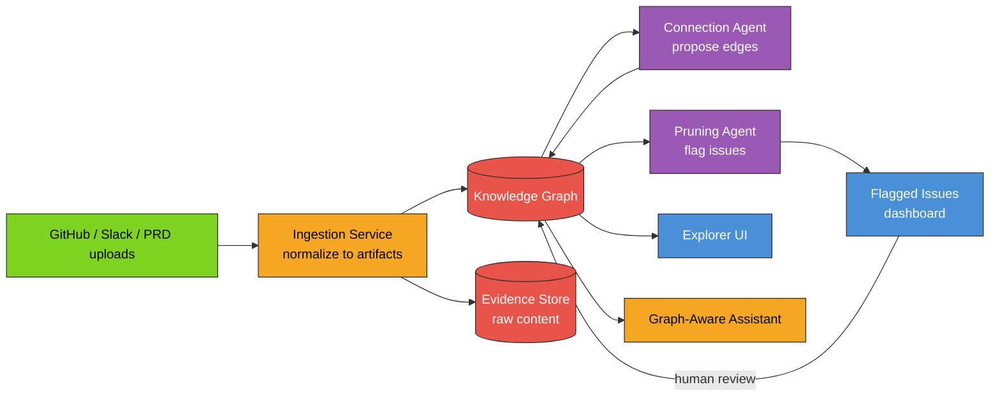
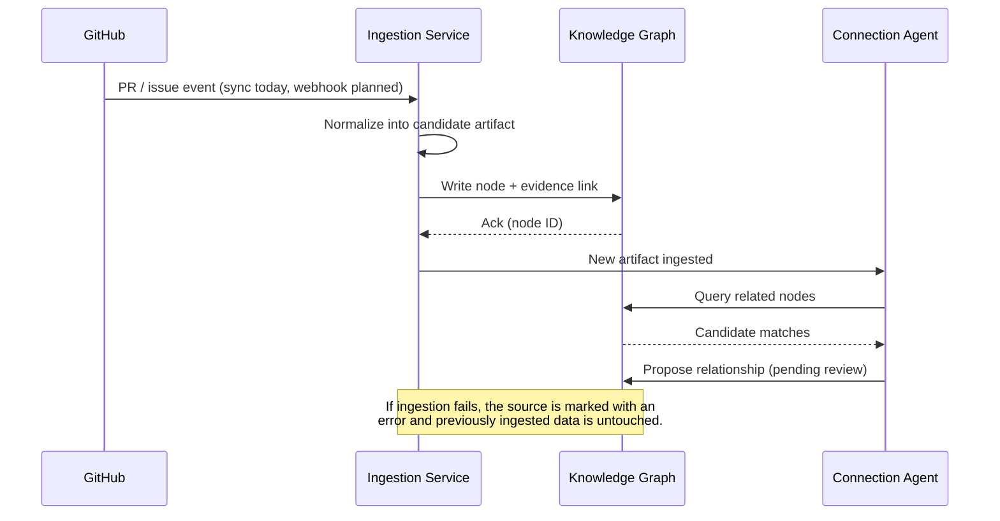
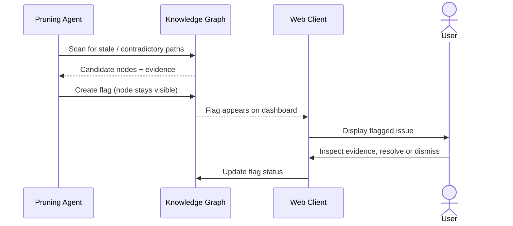
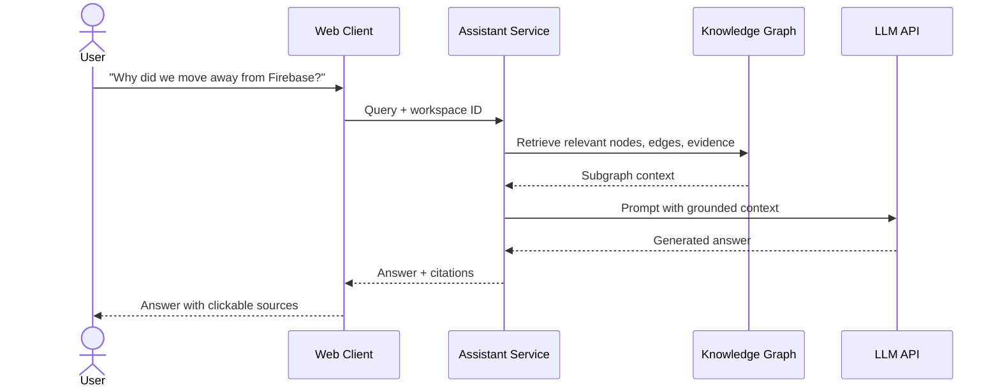

# Cortex

**Auditable project memory for development teams.**

Cortex ingests your project's scattered context (GitHub pull requests and issues, Slack decisions, PRDs) and turns it into a structured, queryable **knowledge graph**. Every node and every edge links back to the raw evidence that produced it, so you can always answer _"why do we believe this?"_

> CS 407 Senior Project · Purdue University

---

## The problem

Decisions get made in Slack threads, argued over in pull requests, and written down (eventually) in a PRD. Months later nobody remembers which one won. Teams end up:

- acting on **contradictory decisions** made on different platforms,
- **repeating mistakes** that were already resolved, and
- asking LLM coding agents for help when those agents have no idea what the team already decided.

Wikis and issue trackers don't fix this because they aren't a single source of truth. General AI tools don't fix it either because they can't trace a claim back to raw evidence.

## What Cortex does

|                              |                                                                                                         |
| ---------------------------- | ------------------------------------------------------------------------------------------------------- |
| 🔌 **Ingests**               | GitHub repos (PRs and issues), Slack channels, and uploaded PDF/Word/text PRDs. Jira is a stretch goal. |
| 🕸️ **Builds a graph**        | Normalizes everything into typed nodes (requirements, decisions, evidence) joined by relationships.     |
| 🔗 **Connection Agent**      | Discovers relationships between artifacts and proposes them for human review.                           |
| ✂️ **Pruning Agent**         | Flags stale, weak, or contradictory information. It never deletes anything.                             |
| 💬 **Graph-Aware Assistant** | Answers natural-language questions about project history, with citations to source evidence.            |
| 🔍 **Explorer UI**           | Visual graph with filtering, search, zoom/pan, and one-click jumps to the original Slack message or PR. |

> **Status:** GitHub ingestion, the Explorer, authentication, workspace roles,
> and the assistant UI/API contract are built. The assistant currently uses a
> deterministic placeholder provider; graph retrieval and a hosted model remain
> planned. Slack, document uploads, and both agents are also planned.

## How it works

<p align="center">
  
</p>

Cortex is a client-server system with a modular, service-oriented backend. The browser talks only to the API/Auth service over HTTPS/REST. The Ingestion service, the two agents, and the Assistant all read and write through one shared knowledge graph. Raw content lives in a separate evidence store and is referenced from the graph rather than copied into it.

### The data lifecycle



1. **Ingest.** A webhook, sync, or upload brings in a raw artifact. The Ingestion service normalizes it into a common format using a shared adapter interface, so new sources can be added without redesigning the pipeline.
2. **Link to evidence.** The artifact becomes a graph node with a pointer to the original content. Nothing enters the graph without provenance.
3. **Connect.** The Connection Agent searches for related nodes and proposes relationships as _pending_ edges.
4. **Prune.** On a schedule, the Pruning Agent sweeps the graph for stale or contradictory paths and raises flags.
5. **Review.** Humans approve or remove proposed edges, and resolve or dismiss flags.
6. **Ask.** Anyone can query the graph through the UI or the chat assistant.

## Core concepts

### Evidence-linked provenance

This is the rule everything else follows. **Every node and every edge resolves to raw evidence.** Open any node and you can jump straight to the Slack message, PR, or document section behind it.

### Node types

| Type                    | What it represents                                                          |
| ----------------------- | --------------------------------------------------------------------------- |
| `Requirement`           | A functional or non-functional requirement from a PRD, issue, or discussion |
| `Decision`              | A recorded team decision (a technology or design choice)                    |
| `Evidence`              | A pointer to raw source content backing a node or edge                      |
| `PullRequest` / `Issue` | Ingested from a connected GitHub repository                                 |
| `SlackMessage`          | Ingested from a connected Slack channel                                     |
| `Document`              | A section of an uploaded PDF or Word file                                   |
| `Flag`                  | A Pruning Agent finding attached to a node or edge                          |

Today the graph holds `Repository`, `Author`, `PullRequest`, and `Issue` nodes, each scoped to a workspace. The other types are planned.

### Relationship types

| Relationship   | Meaning                                              |
| -------------- | ---------------------------------------------------- |
| `SUPPORTS`     | An evidence node supports another node               |
| `REFERENCES`   | One artifact mentions or links to another            |
| `DEPENDS_ON`   | A requirement or decision depends on another         |
| `CONTRADICTS`  | Two nodes hold conflicting information               |
| `DERIVED_FROM` | A node was generated from a specific source artifact |
| `FLAGGED_BY`   | Links a flag to the node or edge it concerns         |

## The two agents

### Connection Agent: discover relationships

Runs shortly after each new artifact is ingested. It queries for related nodes and proposes edges, each with a confidence score and supporting evidence. Proposals are **pending** until a user approves, removes, or leaves them. You can also draw relationships manually when the agent misses one.



### Pruning Agent: flag, never delete

Runs on a periodic sweep over the whole graph. When it finds something stale, weak, or contradictory, it creates a **Flag** and leaves the original node fully visible with a warning icon. Historical context is preserved while a human decides what to trust.



## The Graph-Aware Assistant

The assistant uses **retrieval-augmented generation over your own graph**. It doesn't answer from the LLM's general knowledge. It first retrieves the relevant subgraph and evidence, then prompts the model with that context, and returns the answer with numbered citations back to source artifacts.



Every claim in an answer can be clicked through to the original message, PR, or document, so you never have to take it on faith.


## Tech stack

What the repository uses today. Items marked _planned_ are in the design but not built yet.

| Layer | Choice | Why |
| --- | --- | --- |
| Frontend | Next.js 16 (App Router), React 19, TypeScript, Tailwind CSS 4 | One app for routing, layout, and pages; `/api/*` is proxied to FastAPI |
| Graph rendering | Canvas-based explorer with a force-directed layout | SVG lags beyond a few dozen nodes and edges |
| Backend | Python 3.13.4, FastAPI, Pydantic v2, Uvicorn | Typed request/response validation |
| Relational database | PostgreSQL 16 via SQLAlchemy 2 and Alembic (psycopg 3) | Users, sessions, workspaces, memberships, roles, GitHub credentials, data sources |
| Graph database | Neo4j 5 (official `neo4j` driver) | Relationship traversal is the core operation; nodes are scoped by `workspace_id` |
| Auth | GitHub OAuth plus email/password; HttpOnly session cookies | Passwords hashed with Argon2; GitHub tokens encrypted at rest (Fernet) and never returned by the API |
| Authorization | Per-workspace roles (OWNER, EDITOR, VIEWER, plus custom roles) resolved to permissions on every request | Role changes and removals apply immediately |
| Integrations | GitHub REST (paginated, rate-limit aware) behind a source-adapter pattern | New sources plug in without changing the graph layer; Slack and file upload are _planned_ |
| Testing | pytest (backend), Vitest and Testing Library (frontend) | Backend unit tests need no Docker or network |
| Local infrastructure | Docker Compose (Postgres, Neo4j) | Named volumes keep data between restarts |
| Evidence storage | Object store (_planned_) | Keeps large raw content out of the graph |
| Agents and assistant | Hosted LLM API with strict Pydantic schemas on its output (_planned_) | Focus effort on graph quality and retrieval |

## Getting started

### Supported development environment

Use the tested versions in `.nvmrc` (Node 22.16.0) and `.python-version`
(Python 3.13.4), npm 10.9.2, Docker Compose v2, Bash and curl. The setup is
supported on macOS, Linux and Windows through WSL. CI installs from scratch on
macOS and Linux. Python dependencies use pinned versions and distribution hashes;
frontend dependencies use `apps/web/package-lock.json`. Database images are pinned
by multi-platform digest in `docker-compose.yml`.

### Set up a fresh checkout

With those tools installed and Docker running, run from the repository root:

```bash
nvm install && nvm use
npm run setup
npm run db:setup
npm run dev:watch
```

`setup` creates this checkout's Python environment and installs both lockfiles.
It generates a private `.env` with unique local database passwords and a token
encryption key when no `.env` exists; existing configuration is preserved. Database
setup starts PostgreSQL and Neo4j, waits for authenticated connections, and applies
both schemas. It never resets volumes or seeds user data. Open
[http://localhost:3000](http://localhost:3000) and create an account or sign in.
GitHub, Slack, Discord and hosted assistant credentials are optional; add them to
`.env` when using those integrations. GitHub's OAuth callback is
`http://localhost:3000/auth/github/callback`.

If Python is installed under a different executable name, use
`CORTEX_PYTHON=/path/to/python3.13 npm run setup`. The executable must match
`.python-version`. Rust is not required: setup installs hashed binary wheels.

When dependencies change, stop the app and rerun `npm run setup` followed by
`npm run db:setup`. Setup recreates the local Python environment, removing packages
that are no longer locked. Do not run installs while the app is running. The setup
and startup locks reject overlapping operations; the watchdog checks lockfile
fingerprints, required modules and runtime versions before launching services.

### Check and stop the app

```bash
npm run dev:check              # runtime, dependency locks and backend imports
npm run dev:watch -- --check   # frontend, backend and PostgreSQL health
npm run test:environment       # setup and watchdog regression tests
```

The watchdog logs to `.cortex-dev/`, restarts failed services up to three times
between successful health checks, and stops its own services on Ctrl+C or SIGTERM.
It leaves healthy services it did not start running. Both services bind to
`127.0.0.1`; `CORTEX_BIND_HOST=0.0.0.0` exposes them to other devices.

### Worktrees and existing data

Run `npm run setup` in each worktree. Keep `node_modules` and `backend/.venv`
local to that checkout; sharing `node_modules` by symlink breaks Turbopack's
filesystem boundary. Use the same `.env` and Compose project explicitly if sharing
existing local databases:

```bash
CORTEX_ENV_FILE=/path/to/existing/cortex/.env CORTEX_COMPOSE_PROJECT=cortex npm run db:setup
CORTEX_ENV_FILE=/path/to/existing/cortex/.env npm run dev:watch
```

Stop the other app first, or choose different frontend/backend ports and set
`BACKEND_URL` to the backend port. To isolate databases too, configure different
`POSTGRES_PORT`, `NEO4J_HTTP_PORT` and `NEO4J_BOLT_PORT` values in the worktree's
`.env`, and update `DATABASE_URL` and `NEO4J_URI` to match. Compose uses a separate
project and volumes for each checkout directory by default.

Database passwords belong to existing volumes, not just `.env`. Preserve the
original credentials when reusing data. If authentication fails, check the Compose
project and credentials; do not delete volumes as a routine repair.

### Update dependency locks

Change `backend/requirements.in`, then regenerate `backend/requirements.txt` using
uv 0.13.7 (needed only by maintainers):

```bash
uv pip compile backend/requirements.in --python-version 3.13 --universal --generate-hashes --no-annotate -o backend/requirements.txt
```

Use `--upgrade-package <name>` for intentional Python upgrades. For frontend
changes, update `apps/web/package.json` and its lockfile together. Update runtime
pins and database digests deliberately, then run setup, checks and tests from a
clean checkout. Commit lockfiles with their manifests.

### Tests

```bash
backend/.venv/bin/python -m pytest backend/tests  # backend
npm test                    # frontend, from the repository root
npm run lint
```

## Project structure

```
apps/web/          Next.js frontend (routes in src/app, components in src/components)
backend/app/       FastAPI backend
  api/             Routers: auth, workspaces, roles, graph, ingest, health
  services/        Business rules: workspaces, roles, data sources, GitHub credentials
  models/          SQLAlchemy models
  github/          GitHub client, OAuth, payload models, and Cypher mapper
  graph/           Cypher read queries for the explorer
  db/              Postgres and Neo4j connections and graph constraints
backend/alembic/   Postgres migrations
backend/scripts/   Schema setup, seed data, key rotation
backend/tests/     pytest suite
docker-compose.yml Postgres and Neo4j for local development
docs/images/       Architecture diagram
```

## Roadmap

| Area | Status |
| --- | --- |
| GitHub and email sign-in, sessions, encrypted tokens | Done |
| Workspaces, memberships, roles and custom permissions | Done (backend; role management UI pending) |
| GitHub ingestion of pull requests and issues | Done |
| Graph Explorer with zoom, pan, and node and edge details | Done |
| Source sync status | Done |
| Invite and remove members, delete a workspace | In progress |
| Slack and document ingestion, evidence store | Planned |
| Connection Agent, Pruning Agent, flagged issues dashboard | Planned |
| Graph-Aware Assistant UI and secured placeholder API | Done; graph retrieval and hosted model planned |
| Jira integration | Stretch |

## Design principles

- **Provenance first.** Nothing enters the graph without a link to the raw evidence behind it.
- **Flag, never delete.** Agents raise warnings; humans decide what to trust.
- **Humans review agent output.** Proposed edges stay pending until someone approves them.
- **Adapters, not special cases.** Every source is translated into one common artifact format before it reaches the graph.
- **Validate everything an LLM returns.** Model output must pass strict schemas before it is stored.
- **Secrets stay server-side.** Tokens are encrypted at rest and never returned by the API.

## Team

| Name          | Email               |
| ------------- | ------------------- |
| Parth Ranade  | ranadep@purdue.edu  |
| Ashwath Singh | sing1184@purdue.edu |
| Aryan Jumani  | ajumani@purdue.edu  |
| Kuanyu Chen   | chen4396@purdue.edu |
